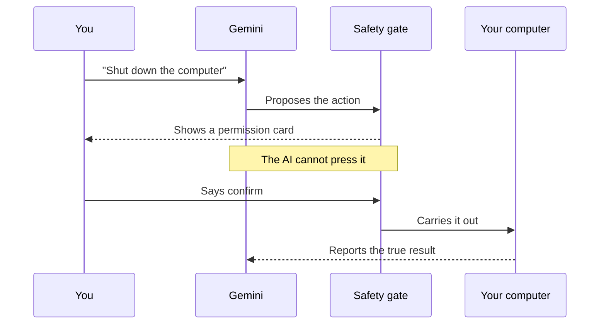
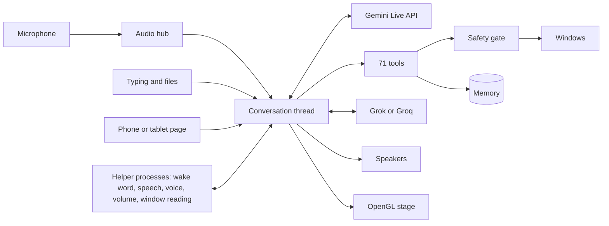

<div align="center">

# APLHA

**A voice-first AI companion for Windows that can see, remember and act on your computer.**

*Written APLHA, spoken "Alpha".*


<sub>Recorded from the real graphics engine, reacting to a simulated voice level.</sub>

[What it does](#what-it-does) · [Safety](#the-safety-gate) · [Architecture](#architecture) · [Install](#install) · [Engineering stories](#engineering-stories) · [Verified or not](#what-has-really-been-verified) · [FAQ](#faq)

</div>

## Why APLHA exists

Most assistants either only chat, or can act but are trusted blindly. APLHA is built around one idea:

> **A language model can ask, but only a person can approve.**

You talk to it, and it answers aloud in real time. It opens apps, handles files, reads PDFs, sets reminders and sends messages. What you ask for runs straight away. Only shutting down and restarting wait for you to say confirm, and no AI output can do that for you.

## What it does

<sub>Click a section to open it.</sub>

<details>
<summary><b>Conversation</b>: real-time voice, hands-free and interrupting</summary>

- Spoken replies in real time through the Gemini Live API
- Hands-free: just speak, or say "hey" or "hi"
- Hold-to-talk on a key, or type
- Press Esc to stop a reply at once
- Each character can have its own voice
</details>

<details>
<summary><b>Two AI brains</b>: Gemini and Grok, chosen by the task</summary>

- Gemini handles live conversation, pictures, the screen and every computer tool
- The second AI is asked for hard reasoning, maths, code, long writing and second opinions
- That is Grok from xAI, or Groq's free models if only a Groq key is saved
- If it fails, Gemini answers itself and says so
- If Gemini cannot answer a typed message, the second AI stands in. It has no tools, so it can answer but never act
- Spoken turns need Gemini unless offline listening is on
</details>

<details>
<summary><b>Professor Mode</b>: lecture slides taught page by page</summary>

- Say "professor mode", or choose it from the More menu
- Pick a course, a lecture and your goal, then choose PDF or picture slides
- Gemini reads the pages itself, so slides in other languages and picture-only slides work
- Slides are taught a few at a time, in order, and "next" moves on
- Only the first line is spoken. Notes appear in their own window
- Buttons for next, simpler, deeper, example, why, quiz and summary, which also work by voice
- Quizzes ask one question at a time and keep a score
- Equations are drawn in the notes, and each lecture ends with a summary, abbreviations and exam questions
- Classes save themselves, and "resume class" picks up at the same slide
- If Gemini cannot answer a question, Groq can stand in, labelled and without seeing the slides
- Export writes the notes to a Markdown file in the course folder, only when asked
- Optional Groq follow-ups, off by default, for questions that need no slides
- Course rules live in private prompt files, which are not published
</details>

<details>
<summary><b>Live translation</b>: an interpreter that speaks as people talk</summary>

- Say "translate Korean into Urdu", or choose it from the More menu
- It finds the spoken language itself and speaks only the translation, about 3 seconds behind
- More than 70 languages to speak in, through Gemini's translation model
- The original and the translation appear side by side, so you can check them
- It stays silent for its own language, so it does not translate itself from the speakers
- Hands-free returns when it stops. Your sound goes to Google while it runs
</details>

<details>
<summary><b>Translated reader</b>: PDFs and screens read aloud in your language</summary>

- Choose a PDF, or say "read my screen in Urdu"
- Gemini translates the whole page as closely as the language allows, with no summary
- The translation appears on screen while Gemini's speech model reads it aloud
- It carries on page by page, and APLHA steps aside before capturing the screen
</details>

<details>
<summary><b>Phone and tablet control</b>: message APLHA from another device</summary>

- Turn it on from the More menu, then scan the QR code with your phone or tablet
- Or open the address shown and enter the six-digit code
- The code works once and lasts five minutes
- Send messages, follow replies and stop a reply from the page
- The main screen shows a pill whenever it is on
- It cannot approve a shutdown, which still waits at the PC
- Only private networks are accepted. The link is not encrypted, so use your own network
</details>

<details>
<summary><b>Computer control</b>: apps, windows, volume and power</summary>

| Say | What happens |
| --- | --- |
| "Open Notepad and type hello" | Opens the app and types, then reports the result |
| "Set the volume to 40" | Sets it, reads it back, and can be undone |
| "Close that window" | Asks the app politely, so it can offer to save |
| "Lock the computer" | Locks straight away |
| "Shut down" | Waits for you to say confirm, then counts down 30 seconds |
| "Video call Ali on WhatsApp" | Opens the chat and presses the call button |
| "Can you see me?" | Turns the camera on and describes the picture |
</details>

<details>
<summary><b>Files and documents</b>: find, read, organise and undo</summary>

- List, find, read, move, rename, copy and organise files
- Read PDFs and text files, and send photos to Gemini
- Nothing is ever overwritten
- Undo reverses moves, renames, copies and whole-folder organising
- Deleting goes to the Recycle Bin
- System folders and folders you list are off limits
</details>

<details>
<summary><b>Daily life</b>: reminders, weather, news and a morning briefing</summary>

- "Remind me in 20 minutes to call home"
- "What's the weather in Seoul?"
- Top headlines, on any topic
- A short spoken briefing on the first start each day
- "Translate what I copied" or "fix the text on my clipboard"
- Music and video from YouTube in your browser, with pause and skip
- YouTube's Skip button pressed for you, in the window you are watching
</details>

<details>
<summary><b>Memory and personalisation</b>: it learns who you are</summary>

- An About me profile, read at the start of each conversation
- Long-term memory you can view, search, edit, export and delete
- Sensitive details are never saved silently
- Your own characters and pictures, kept private on your computer
</details>

<details>
<summary><b>Web watching</b>: alerts for what you care about</summary>

Say "watch this page for exam and scholarship". While it is open, APLHA checks every 15 minutes and alerts you to new lines that match. Pages that need a sign-in are read from your open browser tab, so no password is stored. The page's text goes only to you, never to the AI, so a page cannot give it instructions.
</details>

<details>
<summary><b>Connections and languages</b>: Notion, Gmail, Grok and 100 languages</summary>

- Optional Notion, Gmail and Grok, with keys kept in the Windows Credential Manager
- Message sending through desktop apps. WhatsApp is tested for real
- 100 languages to choose from, or matching how you speak
- The app shows what each speech engine supports for your choice
</details>

## The safety gate

A shutdown or restart needs your own decision: say confirm or cancel, or press the button. Your word is heard by a small speech listener running on your computer, which reads only the microphone. Nothing the AI writes can reach it, and its own voice is ignored.



<details>
<summary><b>What runs at once, and what always asks</b></summary>

| Runs at once when you ask | Waits for your decision |
| --- | --- |
| Opening and closing apps and windows | Shutting down and restarting |
| Moving, deleting and copying files | Changing About me |
| Sending messages and email, and calling | Saving or deleting sensitive memories |
| Typing, clicking and the camera | |
| Volume, reminders, weather and news | |

Changes to personal details need a private spoken keyword, heard only by the listener on your computer. It proves someone knows the word, not who they are.

**The rest relies on the AI understanding you.** With hands-free on, it can also hear other voices nearby, and a page it reads could try to mislead it. An overheard sentence or hidden text can therefore send a message or delete a file. It is told never to act on text it reads, but only the actions in the right-hand column have a hard stop. This is the owner's choice, for speed.
</details>

<details>
<summary><b>Other protections</b></summary>

- The main screen always shows when the microphone is live, and a red pill shows when your voice is being sent
- API keys stay in the Windows Credential Manager, never in a file
- Results are read back where possible, and APLHA says when it could not confirm something
- Words from the AI never go inside a command string
</details>

## Architecture



<details>
<summary><b>How it is built</b></summary>

| Part | Approach |
| --- | --- |
| **Interface** | PySide6, with one custom OpenGL fragment shader drawing the whole scene live |
| **Conversation** | The Gemini Live API on its own thread, so the interface never waits on the network |
| **Crash safety** | Risky native libraries run in helper processes, so a crash costs one feature |
| **Offline speech** | Vosk for wake words, Whisper for recognition and Windows voices for speech |
| **Tools** | 71 declared tools, of which only shutdown, restart and changes to personal details ask |

```text
alpha/
  ui/          Interface, live graphics, panels and the CONFIRM card
  voice/       Gemini session, hands-free logic and offline speech
  audio/       Microphone, speaker and level measurement
  tools/       Everything the assistant can do
  actions.py   The safety gate
  memory.py    Long-term memory
  watchdog.py  Page watching
tests/         873 automated tests
docs/          Requirements, licences and verification record
```
</details>

## Install

| You need | Details |
| --- | --- |
| **System** | Windows. Tested only on Windows 11 |
| **Python** | 3.11, 3.12 or 3.13 |
| **Graphics** | OpenGL 3.3, with a simpler fallback. Tested on integrated AMD graphics |
| **Gemini API key** | From [Google AI Studio](https://aistudio.google.com/apikey), entered on first run |
| **Hardware** | A microphone and speakers for voice. Typing also works |
| **Internet** | Needed for replies, because Gemini does the thinking |

```powershell
powershell -ExecutionPolicy Bypass -File scripts\install.ps1
```

Open APLHA from the desktop shortcut, enter your key, and choose your devices.

<details>
<summary><b>Controls</b></summary>

| Control | What it does |
| --- | --- |
| **F9** | Hold to talk. Change the key in Settings |
| **Esc** | Stops a reply, or leaves fullscreen |
| **F11** | Fullscreen |
| **Left arrow or MESSAGES** | Log, typing box and files |
| **Right arrow or status button** | Readings, characters and controls |
| **More menu** | About me, connections, language, briefing, start with Windows |
</details>

## Engineering stories

Real problems found by running the app, not by reading the code.

<details>
<summary><b>The wake word that heard ghosts</b></summary>

Short words like "hey" were being detected in room noise about every 20 seconds, and each false trigger sent a few seconds of noise to Gemini. **Fix:** a wake word now counts only with clear speech behind it, and APLHA ignores wake words while it is speaking.
</details>

<details>
<summary><b>The photo that was "sent" but never seen</b></summary>

The app said a photo was sent, and automated tests passed, yet real Gemini said it saw nothing. Pictures and text were travelling on separate channels. **Fix:** they now go together, and real Gemini named the shapes and colours in a test picture.
</details>

<details>
<summary><b>Crashes from Python's memory clean-up</b></summary>

Python could clean up interface objects from a background thread, which crashed Qt. **Fix:** clean-up runs only on the interface thread, and the tests enforce it.
</details>

<details>
<summary><b>Making fancy graphics cheap</b></summary>

The first version idled above 30% of a processor core. **Fix:** rendering moved to the graphics chip, and expensive drawing runs only where it can be seen. Idle use, maximised on integrated graphics, was measured at 13 to 17% of one core.
</details>

<details>
<summary><b>Fullscreen that hid its own menus</b></summary>

True fullscreen with OpenGL hid every menu, trapping the user. Leaving it then lost the title bar. **Fix:** a thin window border keeps menus visible, and the window's style is saved and restored by hand.
</details>

<details>
<summary><b>Typing that replaced a selection</b></summary>

In a real test, typing landed in a restored document and replaced selected text. It was undone. **Fix:** a CONFIRM rule was added for named files. The owner later dropped it for direct requests, choosing speed.
</details>

## What has really been verified

Claims here are tested, not assumed. [docs/VERIFICATION.md](docs/VERIFICATION.md) has the full record.

| Status | Features |
| --- | --- |
| **Seen working for real** | Voice conversation, hands-free, Esc, the camera taking a picture, Gemini seeing a shared test picture, opening apps, typing, volume, music, weather, news, clipboard, saving a memory, photos, WhatsApp sending, a sample of language replies |
| **Automated tests only** | Voice calls, video calls, skipping ads, confirming by voice, reminders, the morning briefing, moving and organising files, undo, closing windows, Gmail, Notion, Grok, switching between Gemini and Grok, page watching, lock, sleep, shutdown, restart |
| **Page tried, real devices not yet** | Phone and tablet control, tried in a browser against a pretend assistant |
| **Not yet confirmed for real** | Answers about the screen, recalling a memory, KakaoTalk and other messaging apps |

Tests use a temporary folder, a throwaway key store and pretend sound devices:

```powershell
.venv\Scripts\python -m pip install -r requirements-dev.txt
.venv\Scripts\python -m pytest
```

## FAQ

<details>
<summary><b>Does it work offline?</b></summary>

Not fully. Listening and the voice can run on your computer, but Gemini does the thinking, so replies need the internet.
</details>

<details>
<summary><b>What gets sent to Google?</b></summary>

Your messages, your voice during a turn, pictures you share, your About me at the start of each session, and memories when recalled. With hands-free on, anything said clearly nearby is sent, including other voices. Watched page text stays on your computer.
</details>

<details>
<summary><b>What gets sent to xAI or Groq?</b></summary>

Only with a key saved: the questions Gemini chooses to pass on, and your typed message if Gemini cannot answer it. Your About me is not sent with them.
</details>

<details>
<summary><b>Does it support every language?</b></summary>

100 can be chosen, but only a sample has had a real reply so far. Offline voices depend on what Windows has installed.
</details>

<details>
<summary><b>Can I add my own character?</b></summary>

Yes. Add it to `assets/characters/extra_characters.json`, with a picture of the same name beside it. That folder is not published.
</details>

## Roadmap

- [ ] Other AI providers and local models
- [ ] Plugins
- [ ] A Windows installer
- [x] Reminders, file handling and PDF reading
- [x] 100 languages

## Licence

See [LICENSE](LICENSE). Library licences are in [docs/DEPENDENCIES.md](docs/DEPENDENCIES.md). The figure artwork was made with Canva AI.
