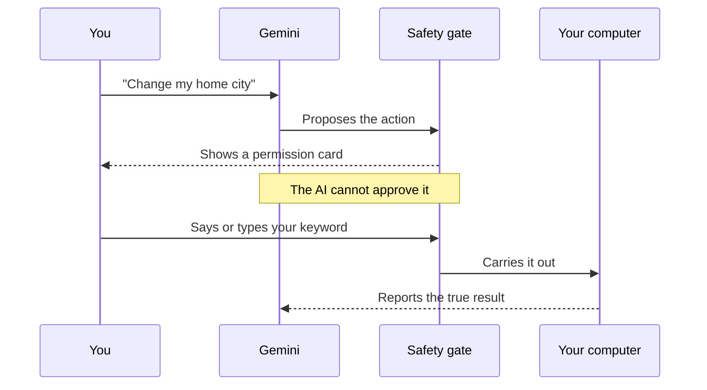
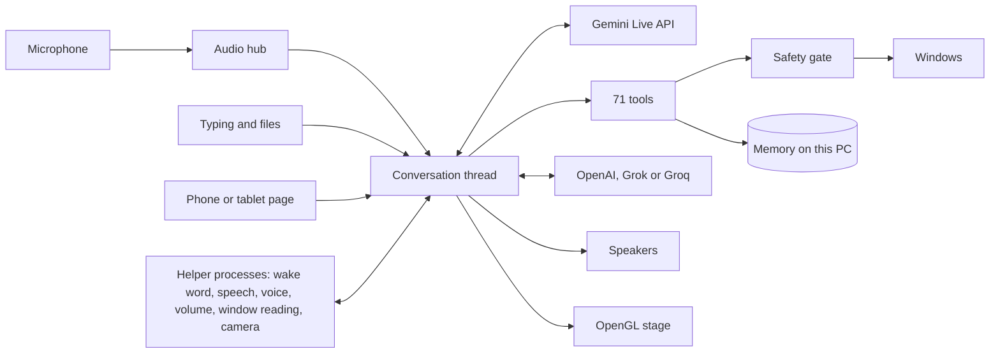

<div align="center">

# APLHA

**A voice-first AI companion for Windows that can see, remember, teach, translate and act on your computer.**

*Written APLHA, spoken "Alpha".*


<sub>Recorded from the real graphics engine, reacting to a simulated voice level.</sub>

[Tour](#a-quick-tour) · [Features](#everything-it-can-do) · [Safety](#the-safety-gate) · [Your data](#where-your-data-lives) · [How it works](#how-it-works) · [Install](#install) · [Verified or not](#what-has-really-been-verified) · [FAQ](#faq)

**[Read the full technical guide](docs/TECHNICAL_GUIDE.md)**

</div>

## Why APLHA exists

Most assistants either only chat, or can act but are trusted blindly. APLHA is built around one idea:

> **A language model can ask, but only a person can approve.**

You talk to it, and it answers aloud in real time. It opens apps, handles files, teaches your lecture slides, translates people as they speak and remembers what matters to you. Everyday requests run straight away, for speed. The actions that matter most wait for you, and no AI output can approve them.

## A quick tour

<table>
<tr><th>Say this</th><th>What happens</th></tr>
<tr><td><i>"Hey, what's on my schedule this week?"</i></td><td>Searches its memory of you, then answers aloud</td></tr>
<tr><td><i>"Open Notepad and type hello"</i></td><td>Opens the app, types, and reports the true result</td></tr>
<tr><td><i>"Professor mode"</i></td><td>Teaches your slides page by page, with quizzes</td></tr>
<tr><td><i>"Translate Korean into Urdu"</i></td><td>Listens to the room and speaks only the translation</td></tr>
<tr><td><i>"Read my screen in Urdu"</i></td><td>Translates what is on screen and reads it aloud</td></tr>
<tr><td><i>"Can you see me?"</i></td><td>Turns the camera on and describes the picture</td></tr>
<tr><td><i>"Video call Ali on WhatsApp"</i></td><td>Opens the chat and presses the call button</td></tr>
<tr><td><i>"Go fullscreen" or "Turn off the mic"</i></td><td>Changes APLHA's own options by voice</td></tr>
<tr><td><i>"Remember that I prefer short answers"</i></td><td>Keeps it for every future conversation</td></tr>
<tr><td><i>"Shut down"</i></td><td>Waits for you to say confirm, then counts down 30 seconds</td></tr>
</table>

## Everything it can do

<sub>Click a section to open it.</sub>

<details>
<summary><b>🎙️ Conversation</b>: real-time voice, hands-free and interrupting</summary>

- Spoken replies in real time through the Gemini Live API
- Hands-free: just speak, or say "hey" or "hi"
- Keep talking for 8 seconds after a reply, with no wake word
- Hold-to-talk on a key you choose, or type
- Press Esc to stop a reply at once
- Each character can have its own voice
- Offline listening and speaking, with Gemini still doing the thinking
</details>

<details>
<summary><b>🧠 Two AI brains</b>: Gemini plus OpenAI, Grok or Groq, chosen by the task</summary>

- Gemini handles live conversation, pictures, the screen and every computer tool
- The second AI is asked for hard reasoning, maths, code, long writing and second opinions
- That is OpenAI first, then Grok from xAI, then Groq's free models, depending on which keys are saved
- If one refuses or its balance runs out, the next is tried
- OpenAI uses its newest "mini" model, which costs far less than the full one, so a small balance lasts
- If it fails, Gemini answers itself and says so
- If Gemini cannot answer a typed message, the second AI stands in. It has no tools, so it can answer but never act
- Spoken turns need Gemini unless offline listening is on
</details>

<details>
<summary><b>🎓 Professor Mode</b>: lecture slides taught page by page</summary>

- Say "professor mode", or choose it from the More menu
- Pick a course, a lecture and your goal, then choose PDF or picture slides
- Gemini reads the pages itself, so slides in other languages and picture-only slides work
- Slides are taught 5 to 8 at a time, in order, and "next" moves on
- Only the first line is spoken. Notes appear in their own window
- Buttons for next, simpler, deeper, example, why, quiz and summary, which also work by voice
- Quizzes ask one question at a time, and the app keeps the score
- Equations are drawn in the notes, and each lecture ends with a summary, abbreviations and exam questions
- Classes save themselves, and "resume class" picks up at the same slide
- If a Gemini model reaches its limit, a spare takes over and says so on screen
- If Gemini cannot answer a question, Groq can stand in, labelled and without seeing the slides
- Export writes the notes to a Markdown file in the course folder, only when asked
- Course rules live in private prompt files, which are not published
</details>

<details>
<summary><b>🌍 Live translation</b>: an interpreter that speaks as people talk</summary>

- Say "translate Korean into Urdu", or choose it from the More menu
- It finds the spoken language itself and speaks only the translation, about 3 seconds behind
- More than 70 languages to speak in, through Gemini's translation model
- The original and the translation appear side by side, so you can check them
- It stays silent for its own language, so it does not translate itself from the speakers
- Hands-free returns when it stops. Your sound goes to Google while it runs
</details>

<details>
<summary><b>📖 Translated reader</b>: PDFs and screens read aloud in your language</summary>

- Choose a PDF, or say "read my screen in Urdu"
- Gemini translates the whole page as closely as the language allows, with no summary
- Anything it cannot read is marked, not guessed
- The translation appears on screen while Gemini's speech model reads it aloud
- It carries on page by page, and APLHA steps aside before capturing the screen
</details>

<details>
<summary><b>📱 Phone and tablet control</b>: message APLHA from another device</summary>

- Turn it on from the More menu, then scan the QR code with your phone or tablet
- Or open the address shown and enter the six-digit code
- The code works once and lasts five minutes
- Send messages, follow replies and stop a reply from the page
- The main screen shows a pill whenever it is on
- It cannot approve anything. That stays at the PC
- Only private networks are accepted. The link is not encrypted, so use your own network
</details>

<details>
<summary><b>💻 Computer control</b>: apps, windows, volume and power</summary>

| Say | What happens |
| --- | --- |
| "Open Notepad and type hello" | Opens the app and types, then reports the result |
| "Set the volume to 40" | Sets it, reads it back, and can be undone |
| "Close that window" | Asks the app politely, so it can offer to save |
| "Lock the computer" | Locks straight away |
| "Shut down" | Waits for you to say confirm, then counts down 30 seconds |
| "Video call Ali on WhatsApp" | Opens the chat and presses the call button |
| "Can you see me?" | Turns the camera on and describes the picture |
</details>

<details>
<summary><b>🗣️ Voice control of APLHA</b>: change its options by speaking</summary>

Say any of these: fullscreen on or off, compact on or off, always on top on or off, hands-free on or off, mic off, hide to tray, open memory, or open connections. You can also open Professor Mode, live translation and the reader by voice.

Turning the mic off stops APLHA hearing you, so it has to be turned back on by hand.
</details>

<details>
<summary><b>📁 Files and documents</b>: find, read, organise and undo</summary>

- List, find, read, move, rename, copy and organise files
- Read PDFs and text files, and send photos to Gemini
- Nothing is ever overwritten
- Undo reverses moves, renames, copies and whole-folder organising
- Deleting goes to the Recycle Bin
- System folders and folders you list are off limits
</details>

<details>
<summary><b>☀️ Daily life</b>: reminders, weather, news and a morning briefing</summary>

- "Remind me in 20 minutes to call home"
- "What's the weather in Seoul?"
- Top headlines, on any topic
- A short spoken briefing on the first start each day
- "Translate what I copied" or "fix the text on my clipboard"
- Music and video from YouTube in your browser, with pause and skip
- YouTube's Skip button pressed for you, in the window you are watching
</details>

<details>
<summary><b>💾 Memory and learning</b>: it learns who you are and how you like things</summary>

- An About me profile, read at the start of each conversation
- Long-term memory you can view, search, edit, export and delete
- Sensitive details are never saved silently
- It learns short rules from your corrections and praise. Rules grow stronger when repeated, and fade if you say they were wrong
- Your own characters and pictures, kept private on your computer

This learning is a scored list of rules, not a neural network being trained. The [technical guide](docs/TECHNICAL_GUIDE.md#how-learning-works) explains how it works.
</details>

<details>
<summary><b>👀 Web watching</b>: alerts for what you care about</summary>

Say "watch this page for exam and scholarship". While it is open, APLHA checks every 15 minutes and alerts you to new lines that match. Pages that need a sign-in are read from your open browser tab, so no password is stored. The page's text goes only to you, never to the AI, so a page cannot give it instructions.
</details>

<details>
<summary><b>🔌 Connections and languages</b>: Notion, Gmail, OpenAI, Grok, Groq and 100 languages</summary>

- Optional Notion, Gmail, OpenAI, Grok and Groq, with keys kept in the Windows Credential Manager
- Message sending through desktop apps. WhatsApp is tested for real
- 100 languages to choose from, or matching how you speak
- The app shows what each speech engine supports for your choice
</details>

## The safety gate

Four actions wait for your own decision. Your spoken word is heard by a small speech listener running on your computer, which reads only the microphone. Nothing the AI writes can reach it, and its own voice is ignored.



| Action | How you approve it |
| --- | --- |
| Shutting down or restarting | Say confirm, or press CONFIRM |
| Changing About me | Say or type your keyword. There is no button |
| Saving a sensitive memory | Say or type your keyword. There is no button |
| Deleting a memory | Say or type your keyword. There is no button |

<details>
<summary><b>What runs at once</b></summary>

Everything else runs when you ask, because the owner chose speed: opening and closing apps, moving and deleting files, sending messages and email, calling, typing, clicking, the camera, volume and reminders.

**That relies on the AI understanding you.** With hands-free on, it can also hear other voices nearby, and a page it reads could try to mislead it. An overheard sentence or hidden text could send a message or delete a file. It is told never to act on text it reads, but only the four actions above have a hard stop.

The keyword proves someone knows the word, not who they are.
</details>

<details>
<summary><b>Other protections</b></summary>

- The main screen always shows when the microphone is live, and a red pill shows when your voice is being sent
- API keys and the keyword stay in the Windows Credential Manager, never in a file
- Results are read back where possible, and APLHA says when it could not confirm something
- Words from the AI never go inside a command string
- A second AI has no tools, so it can never act
</details>

## Where your data lives

Your personal data stays on your computer, in `%APPDATA%\ALPHA`, and is never in this repository.

| What | Where | Encrypted? |
| --- | --- | --- |
| Long-term memories | `memory.sqlite`, a SQLite database | No |
| About me | `about_me.json` | No |
| Learned rules | `lessons.json` | No |
| Settings, reminders, watched pages | JSON files | No |
| API keys and the keyword | Windows Credential Manager | Yes, by Windows |
| Conversations | Not saved. Gone when APLHA closes | Not stored |

Anyone with access to your Windows account could read the unencrypted files.

<details>
<summary><b>What is sent, and to whom</b></summary>

| Goes to | What | When |
| --- | --- | --- |
| Google Gemini | Your voice and messages | During each turn |
| Google Gemini | About me and your 25 strongest rules | Start of each session |
| Google Gemini | Up to 5 relevant memories | Only when recalled |
| Google Gemini | Pictures, slides and pages | When you share or use them |
| OpenAI, xAI or Groq | Questions Gemini passes on | Only with a key saved |
| Open-Meteo, Google News | City or topic | For weather and news |

The keyword and the text of watched pages are not sent. Say your keyword only while a permission card is showing, because at any other time it is ordinary speech.
</details>

## How it works



<details>
<summary><b>How it is built</b></summary>

| Part | Approach |
| --- | --- |
| **Interface** | PySide6, with one custom OpenGL fragment shader drawing the whole scene live |
| **Conversation** | The Gemini Live API on its own thread, so the interface never waits on the network |
| **Crash safety** | Risky native libraries run in helper processes, so a crash costs one feature |
| **Offline speech** | Vosk for wake words, Whisper for recognition and Windows voices for speech |
| **Tools** | 71 declared tools, of which 4 always wait for you |
| **Memory** | SQLite with word matching, not embeddings |
| **Secrets** | Windows Credential Manager, through keyring |

```text
alpha/
  ui/          Interface, live graphics, panels and the permission card
  voice/       Gemini session, hands-free logic and offline speech
  audio/       Microphone, speaker and level measurement
  tools/       Everything the assistant can do
  professor/   Teaching lecture slides
  actions.py   The safety gate
  memory.py    Long-term memory
  lessons.py   Rules learned from you
  remote.py    Phone and tablet page
  watchdog.py  Page watching
tests/         921 automated tests
docs/          Technical guide, requirements, licences and verification record
```

**More detail:** the [technical guide](docs/TECHNICAL_GUIDE.md) covers threads, a voice turn step by step, every stored file, each AI model, limits and answers to common questions.
</details>

<details>
<summary><b>Engineering stories</b>: real problems found by running the app</summary>

**The keyword that leaked.** Testing with a real voice showed the private keyword appearing in the chat. APLHA keeps a moment of recent sound so it does not cut off your first word, and that sound carried the keyword into the next turn. **Fix:** the sound is now thrown away after a decision, with a 2 second pause before listening again.

**The wake word that heard ghosts.** Short words like "hey" were detected in room noise about every 20 seconds, and each false trigger sent noise to Gemini. **Fix:** a wake word now counts only with clear speech behind it, and is ignored while APLHA speaks.

**The photo that was "sent" but never seen.** The app said a photo was sent and tests passed, yet real Gemini saw nothing, because pictures and text were on separate channels. **Fix:** they now go together, and real Gemini named the shapes in a test picture.

**The false daily limit.** A class stopped, saying the daily limit was used up, when the word "day" had only appeared in a short limit's message. **Fix:** only a requested wait of 10 minutes or more counts as daily, and spare models take over.

**Crashes from Python's memory clean-up.** Python could clean up interface objects from a background thread, which crashed Qt. **Fix:** clean-up runs only on the interface thread, and tests enforce it.

**Making fancy graphics cheap.** The first version idled above 30% of a processor core. **Fix:** rendering moved to the graphics chip. Idle use, maximised on integrated graphics, was measured at 13 to 17% of one core.

**Fullscreen that hid its own menus.** True fullscreen with OpenGL hid every menu. **Fix:** a thin window border keeps menus visible, and the window's style is saved and restored by hand.
</details>

## Install

| You need | Details |
| --- | --- |
| **System** | Windows. Tested only on Windows 11 |
| **Python** | 3.11, 3.12 or 3.13 |
| **Graphics** | OpenGL 3.3, with a simpler fallback. Tested on integrated AMD graphics |
| **Gemini API key** | From [Google AI Studio](https://aistudio.google.com/apikey), entered on first run |
| **Hardware** | A microphone and speakers for voice. Typing also works |
| **Internet** | Needed for replies, because Gemini does the thinking |

```powershell
powershell -ExecutionPolicy Bypass -File scripts\install.ps1
```

Open APLHA from the desktop shortcut, enter your key, and choose your devices.

<details>
<summary><b>Controls</b></summary>

| Control | What it does |
| --- | --- |
| **F9** | Hold to talk. Change the key in Settings |
| **Esc** | Stops a reply, or leaves fullscreen |
| **F11** | Fullscreen |
| **Left arrow or MESSAGES** | Log, typing box and files |
| **Right arrow or status button** | Readings, characters and controls |
| **More menu** | About me, connections, Professor Mode, translation, phone control, language, briefing, start with Windows |
</details>

## What has really been verified

Claims here are tested, not assumed. [docs/VERIFICATION.md](docs/VERIFICATION.md) has the full record.

| Status | Features |
| --- | --- |
| **Seen working for real** | Voice conversation, hands-free, voice control of options, the spoken keyword and spoken cancel, Esc, a full Professor Mode class with resume and quiz, spare-model switching, live translation of a real speaker, the translated reader, Groq answering, the camera taking a picture, opening apps, typing, volume, music, weather, news, clipboard, saving a memory, photos, WhatsApp sending, a sample of language replies |
| **Automated tests only** | Voice calls, video calls, skipping ads, saying confirm, reminders, the morning briefing, moving and organising files, undo, closing windows, Gmail, OpenAI, Grok itself, page watching, lock, sleep, shutdown, restart |
| **Drawn but not yet used for real** | The typed keyword on the permission card |
| **Page tried, real devices not yet** | Phone and tablet control, tried in a browser against a pretend assistant |
| **Not yet confirmed for real** | Answers about the screen, recalling a memory, Notion pages, KakaoTalk and other messaging apps |

Tests use a temporary folder, a throwaway key store and pretend sound devices:

```powershell
.venv\Scripts\python -m pip install -r requirements-dev.txt
.venv\Scripts\python -m pytest
```

## FAQ

<details>
<summary><b>Where does it store memory?</b></summary>

On your computer, in `%APPDATA%\ALPHA\memory.sqlite`. It is not encrypted, and it is not in this repository. Only relevant memories are sent to Gemini, up to 5 at a time.
</details>

<details>
<summary><b>Is this its own AI model?</b></summary>

No. The thinking comes from Gemini, with OpenAI, Grok or Groq as a second AI. This project is the application around them: real-time sound, tools, memory, safety, interface and teaching.
</details>

<details>
<summary><b>Does it work offline?</b></summary>

Not fully. Listening and the voice can run on your computer, but Gemini does the thinking, so replies need the internet.
</details>

<details>
<summary><b>Does it listen all the time?</b></summary>

With hands-free on, the microphone is open and sound is checked on your computer. It is sent to Google only during a turn, which starts on clear speech or a wake word. That includes other voices nearby.
</details>

<details>
<summary><b>Does it use deep reinforcement learning?</b></summary>

No. It keeps scored rules from your corrections and praise. No neural network is trained here.
</details>

<details>
<summary><b>Does it recognise my voice?</b></summary>

No. A keyword protects sensitive changes, which proves someone knows the word, not who they are.
</details>

<details>
<summary><b>Does it support every language?</b></summary>

100 can be chosen, but only a sample has had a real reply so far. Offline voices depend on what Windows has installed.
</details>

<details>
<summary><b>Can I add my own character?</b></summary>

Yes. Add it to `assets/characters/extra_characters.json`, with a picture of the same name beside it. That folder is not published.
</details>

<details>
<summary><b>More questions</b></summary>

The [technical guide](docs/TECHNICAL_GUIDE.md#questions-and-answers) answers more, including embeddings, prompt injection and what it costs to run.
</details>

## Roadmap

- [ ] Other AI providers and local models
- [ ] Plugins
- [ ] A Windows installer
- [ ] Recognising the owner's voice
- [x] Reminders, file handling and PDF reading
- [x] 100 languages
- [x] Professor Mode, live translation and the translated reader

## Licence

See [LICENSE](LICENSE). Library licences are in [docs/DEPENDENCIES.md](docs/DEPENDENCIES.md). The figure artwork was made with Canva AI.
