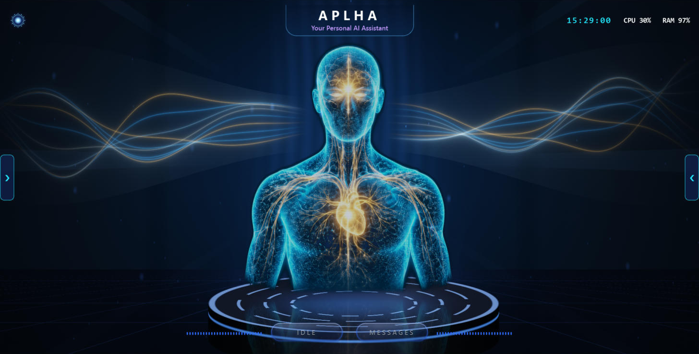

# APLHA

**A voice-first personal AI companion for Windows that can see, remember and act on your computer, with a safety gate the AI cannot press for itself.**

*Written APLHA, spoken "Alpha". The code and folders use `alpha`.*



APLHA is a desktop assistant built with Python, PySide6 and the Gemini Live API. You talk to it, and it talks back in real time. It can open apps, handle files, read PDFs, set reminders, control the volume, watch a web page and send messages, while a live figure of light reacts to its voice.

Most assistants either only chat, or can act but are trusted blindly. APLHA is built around one idea: **a language model can ask, but only a person can approve.**

## What it does

| Area | What you can do |
| --- | --- |
| **Conversation** | Real-time spoken replies, typing, hands-free talking, hold-to-talk, and Esc to stop a reply |
| **Computer control** | Open apps and websites, manage windows, type, press keys, set volume and brightness, lock, sleep, shut down |
| **Files** | List, find, read, move, rename, copy and organise files, with undo. Delete sends to the Recycle Bin after CONFIRM |
| **Documents** | Read PDFs and text files, and send photos to Gemini |
| **Daily life** | Reminders, weather, news headlines, a morning briefing and clipboard help |
| **Messages** | WhatsApp sending tested for real. KakaoTalk, Telegram, Discord, Slack and Teams use the same route, not yet tested on the real apps |
| **Web watching** | Checks a page every 15 minutes and alerts you to new lines that match your words |
| **Memory** | Long-term memory you can view, search, edit, export and delete, plus an About me profile |
| **Seeing** | Shares the screen or camera only while you switch it on |
| **Languages** | English, Korean, Urdu and Hindi, with what each engine supports shown in the app |
| **Connections** | Optional Notion, Gmail and Grok |
| **Interface** | A live scene drawn on the graphics chip, with energy waves that follow the voice |

## Built for safety

- **The model cannot approve itself.** A CONFIRM can only come from a real mouse press on the on-screen button. No tool can do it.
- **Sensitive actions always ask.** Sending to other people, deleting, shutting down, clicking at a screen position, and anything mentioning money or passwords.
- **Outside text is treated as data.** After APLHA reads a page, email or file, actions that would normally run straight away need CONFIRM again, so a page cannot quietly give it instructions.
- **Live inputs are always shown.** The main screen always shows when the microphone is live, and a red pill shows when your voice is being sent.
- **Keys stay out of files.** API keys are kept in the Windows Credential Manager.
- **Results are reported honestly.** APLHA reads settings back after changing them, and says when it could not confirm something.
- **Risky native code is isolated.** Speech, volume and window reading run in separate helper processes, so a crash there costs one feature, not the app.

## What you need

| Requirement | Details |
| --- | --- |
| **System** | Windows. Tested only on Windows 11 |
| **Python** | 3.11, 3.12 or 3.13 |
| **Graphics** | OpenGL 3.3. Tested on integrated AMD graphics, with a simpler fallback for machines without it |
| **Gemini API key** | From [Google AI Studio](https://aistudio.google.com/apikey). Entered on first run |
| **Hardware** | A microphone and speakers for voice. Typing also works |
| **Internet** | Needed for replies, because Gemini does the thinking |
| **Optional** | Notion token, Google OAuth client for Gmail, and xAI key for Grok |

## Install

In PowerShell, from the project folder:

```powershell
powershell -ExecutionPolicy Bypass -File scripts\install.ps1
```

This creates a private Python environment, downloads the offline speech models and adds a desktop shortcut. To use a specific Python, add `-Python "C:\path\to\python.exe"`.

## First run

Open APLHA from the desktop shortcut, enter your Gemini key, and choose your microphone and speakers.

- **Talk:** hold **F9**, or the key you chose in Settings, while APLHA is in front.
- **Hands-free:** on by default once set up. Just speak, or say "hey" or "hi". Anything said clearly nearby goes to Gemini, including other voices and the TV. Turning it off is remembered.
- **Panels:** the left arrow or MESSAGES opens the log, typing box and files. The right arrow or the status button opens readings, characters and controls.
- **Esc:** stops a reply, or leaves fullscreen.

Try saying:

- "Remind me in 20 minutes to call home."
- "What's the weather in Seoul?"
- "Organise my Downloads folder." Then say "undo".
- "Read my lecture PDF and summarise it."
- "Translate what I copied."
- "Watch this page for exam and scholarship."

## How it is built

```text
alpha/
  ui/       Interface, live graphics, panels and the CONFIRM card
  voice/    Gemini Live session, hands-free logic and offline speech
  audio/    Microphone, speaker and level measurement
  tools/    Everything the assistant can do
  actions.py    The safety gate
  memory.py     Long-term memory
  watchdog.py   Page watching
tests/      Automated tests
docs/       Requirements, licences and verification record
```

- **Interface:** PySide6 with a custom OpenGL fragment shader, keeping idle processor use low on integrated graphics.
- **Conversation:** the Gemini Live API over a session running on its own thread, so the interface never waits on the network.
- **Offline speech:** Vosk for listening for wake words, Whisper for recognition and Windows voices for speech, each in its own process.
- **Safety:** a gate that needs a proof object only the real button press can create.

## Tests

```powershell
.venv\Scripts\python -m pip install -r requirements-dev.txt
.venv\Scripts\python -m pytest
```

Tests use a temporary folder, a throwaway key store and pretend sound devices, so they cannot reach your microphone, settings, keys or the internet. `scripts\dev_run.py` runs the real app against a pretend Gemini, with no key.

[docs/VERIFICATION.md](docs/VERIFICATION.md) separates what was seen working in the real app from what has automated tests only.

## Privacy

Your messages, your voice while a turn is active, and any picture you share go to Google through the Gemini API. Your About me goes with each session, and memories go only when recalled. Weather requests go to Open-Meteo and news requests to Google News. Text from watched pages stays on your computer.

## Limitations

- Windows only, and tested on one laptop.
- Gemini does the thinking, so there is no fully offline mode yet.
- Page watching and reminders work only while APLHA is open.
- Text in scanned PDFs cannot be read.
- Offline voices depend on the languages installed in Windows.

## Roadmap

Other AI providers and local models, plugins, keeping a conversation after a dropped connection, and a Windows installer.

## Licence

See [LICENSE](LICENSE). Library licences are listed in [docs/DEPENDENCIES.md](docs/DEPENDENCIES.md). The figure artwork was made with Canva AI.
