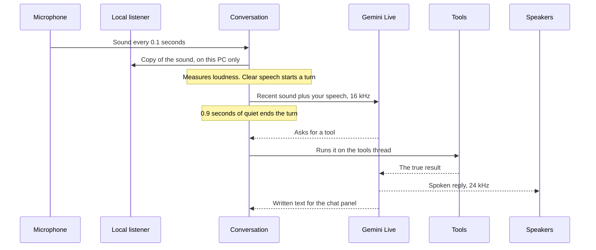
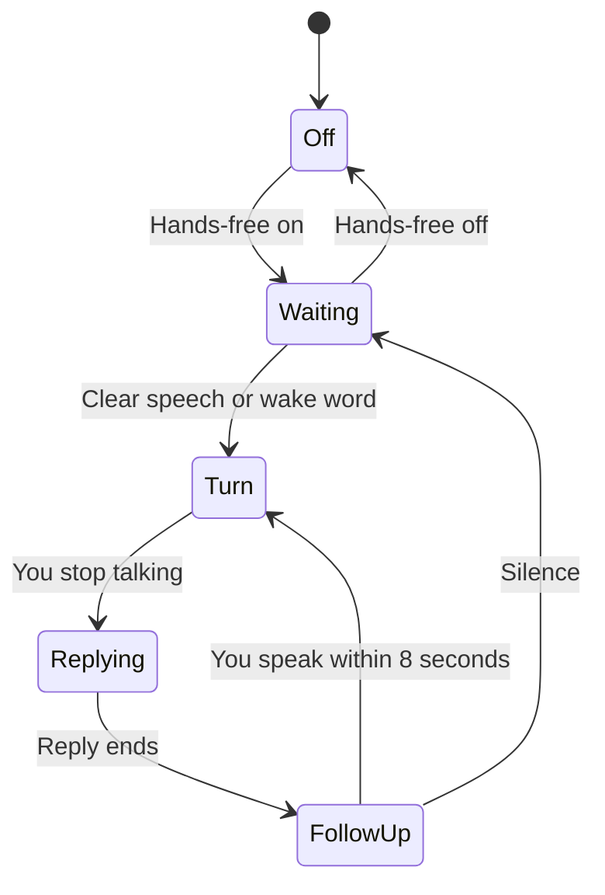
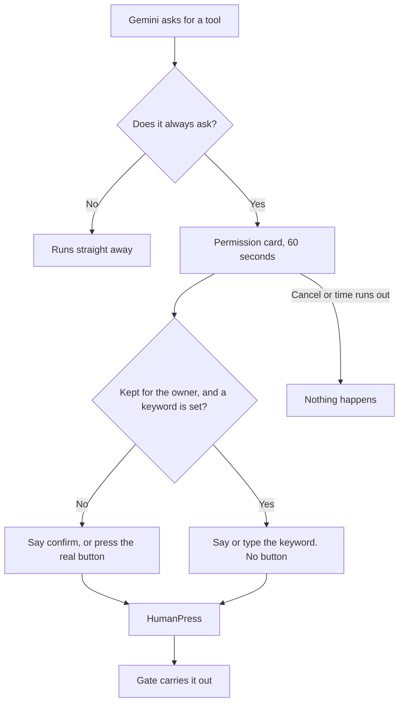

# APLHA technical guide

How APLHA works inside, where everything is kept, and how to answer the questions people ask about it.

**Jump to:** [Summary](#the-short-version) · [Stack](#the-technology-stack) · [Structure](#how-the-program-is-organised) · [A voice turn](#what-happens-when-you-speak) · [Storage](#where-everything-is-stored) · [What leaves the PC](#what-leaves-your-computer) · [Tools](#how-tools-work) · [Safety](#the-safety-gate-and-keyword) · [Memory](#how-memory-works) · [Learning](#how-learning-works) · [AI models](#which-ai-does-what) · [Features](#how-the-main-features-work) · [Reliability](#reliability) · [Testing](#testing) · [Limits](#known-limits) · [Questions](#questions-and-answers)

## The short version

APLHA is a Windows desktop app written in Python. It is about 10,500 lines of code in 84 files, with another 6,100 lines of automated tests.

The app itself is not an AI. It is the body around one: the microphone, speakers, screen, tools, memory and safety rules. The thinking is done by Google's Gemini over the internet, and a small speech model on the PC listens for wake words, "confirm", "cancel" and the keyword.

Three design rules explain most of it:

1. **The interface never waits.** Network, sound and tool work all run away from the window, so it stays smooth.
2. **Risky code runs in its own process.** If a camera driver or speech library crashes, you lose that feature, not the app.
3. **Safety rules are in code, not in the AI's instructions.** The AI can ask for an action, but it has no route to approve one that needs you.

## The technology stack

| Layer | Technology | Why it is used |
| --- | --- | --- |
| Language | Python 3.11 to 3.13 | Has good libraries for AI, sound and Windows |
| Interface | PySide6 (Qt) | A native desktop window with panels and dialogs |
| Graphics | OpenGL fragment shader | The graphics chip draws the stage, which keeps processor use low |
| Main AI | Gemini Live API, through `google-genai` | Two-way real-time voice over a live connection |
| Teaching and reading AI | Gemini text models | Reads whole PDF and picture pages |
| Second AI | Grok (xAI) or Groq, through `httpx` | Harder thinking, and a stand-in for typed messages |
| Wake words | Vosk, `vosk-model-small-en-us-0.15` | Runs on the PC, with no network |
| Offline hearing | faster-whisper, `base` model | Turns speech into text on the PC |
| Offline voice | Windows speech voices | Speaks with no network |
| Sound | sounddevice, numpy | Microphone and speakers |
| Secrets | keyring, Windows Credential Manager | Keys never sit in a plain file |
| Long-term memory | SQLite | A small database file with no server |
| Reading apps | Windows UI Automation, through comtypes | Reads what is inside windows |
| Controlling Windows | ctypes (`SendInput`), pycaw, PowerShell | Keyboard, mouse, volume and brightness |
| Camera and screen | opencv-python-headless, mss | Single pictures |
| Documents | pypdf, pypdfium2, matplotlib | Page handling, page pictures and drawn equations |
| System readings | psutil | The live CPU, memory, disk and network numbers |

Every version is fixed in `requirements.txt`, so an install gets exactly what was tested.

## How the program is organised

```text
alpha/
  app.py               Start-up: logging, single copy check, window, conversation
  actions.py           The safety gate
  memory.py            Long-term memory (SQLite)
  profile.py           About me
  lessons.py           Scored lessons learned from the owner
  keystore.py          Credential Manager access
  settings.py          User settings
  paths.py             Where files live
  remote.py            Phone and tablet page
  watchdog.py          Page watching
  reminders.py         Reminders
  page_reader.py       The translated reader
  audio/               Microphone, speakers and the audio thread
  voice/               Gemini session, hands-free, persona, offline speech
  tools/               Everything the assistant can do
  professor/           Professor Mode
  ui/                  Windows, panels, the stage and the permission card
tests/                 Automated tests
docs/                  This guide, requirements, licences, verification record
scripts/               The installer
```

### Threads

A thread is one line of work inside the program. APLHA keeps slow work off the interface thread.

| Thread | Its job |
| --- | --- |
| Interface | Draws the window and handles clicks. Nothing slow may run here |
| `alpha-conversation` | One asyncio loop that holds the live Gemini connection |
| `alpha-tools` | Runs tools one at a time, in order |
| `alpha-audio` | The only thread allowed to touch sound devices |
| Short-lived helpers | Professor calls, reader work, connection checks, phone page |

### Helper processes

A process is a separate running program, so a crash inside one cannot take the app down. This is why APLHA can show four running processes in Task Manager: Python's launcher and the app, then the same pair for the wake word listener.

| Helper | File | Job |
| --- | --- | --- |
| Wake listener | `voice/wake_worker.py` | Hears wake words and decisions, using no network |
| Speech to text | `voice/stt_worker.py` | Offline hearing with Whisper |
| Text to speech | `voice/tts_worker.py` | Offline Windows voice |
| Camera and screen | `vision_worker.py` | Takes one picture, then exits and frees the camera |
| Window reader | `tools/uia_worker.py` | Reads text inside other apps |
| Volume | `tools/volume_worker.py` | Windows volume control |

### Start-up, in order

1. Logging and crash recording start.
2. `readiness` checks that required parts are installed.
3. A lock file checks for a running copy. If one exists, it is woken instead of starting a second.
4. Settings load, then the audio hub, conversation and main window are created.
5. Python's memory clean-up is moved to the interface thread.
6. The window opens maximised, and hands-free starts if it is turned on.
7. After 15 seconds, the morning briefing runs if it has not run today.

## What happens when you speak



### Hands-free states

Sound is sent to Google only in the **turn** state. This is enforced by one property in `voice/hands_free.py`.



| Measurement | Value |
| --- | --- |
| Sound chunk | 0.1 seconds |
| Sound kept from just before a turn | 0.6 seconds, so your first word is not cut off |
| Quiet that ends a turn | 0.9 seconds |
| Longest turn | 25 seconds |
| Follow-up window | 8 seconds |
| Sound to Gemini | 16 kHz, 16-bit, mono |
| Sound from Gemini | 24 kHz |

The app learns the room's background noise over time and raises its speech threshold, so a fan is not treated as a voice. A wake word counts only with clear speech behind it, and sound from APLHA's own voice is ignored.

## Where everything is stored

Personal data lives in `%APPDATA%\ALPHA`, usually `C:\Users\<you>\AppData\Roaming\ALPHA`. None of it is in the GitHub repository.

| What | Where | Format | Encrypted? |
| --- | --- | --- | --- |
| Long-term memories | `memory.sqlite` | SQLite database | No |
| About me | `about_me.json` | JSON | No |
| Lessons | `lessons.json` | JSON | No |
| Settings | `settings.json` | JSON, with no keys | No |
| Reminders | `reminders.json` | JSON | No |
| Watched pages | `watches.json` | JSON | No |
| Private off-limits folders | `off_limits.txt` | One folder per line | No |
| Files APLHA creates | `Created files\` | Text files | No |
| Your character pictures | `characters\` | Pictures | No |
| Offline speech models | `models\` | Model files | Not needed |
| Activity log | `logs\alpha.log` | Text, up to 1 MB plus 2 old copies | No |
| Native crash record | `logs\crash.txt` | Text | No |
| API keys and the keyword | Windows Credential Manager | Service name `ALPHA` | Yes, by Windows |
| Saved classes | `sessions\` in the app folder | JSON | No |
| Course setup and prompts | `config\professor.json`, `prompts\professor\` | JSON and text | No |
| Exported class notes | The course's own folder, only when asked | Markdown | No |

**Conversations are not saved.** The chat panel lives in memory and is gone when APLHA closes. What carries over is About me, memories and lessons. Professor Mode is the exception, because a class saves itself so it can be resumed.

**The log does not record what was said.** It records events, such as "Hands-free is now turn".

**Credential Manager entries:** `gemini-api`, `xai-key`, `groq-key`, `notion-token`, `owner-keyword`, `gmail-client-id`, `gmail-client-secret` and `gmail-refresh-token`.

**Important files are written safely.** Most data files are written to a temporary file first, then swapped into place, so a crash cannot leave half a file.

## What leaves your computer

| Destination | What is sent | When |
| --- | --- | --- |
| Google Gemini | Your voice during a turn, and typed messages | Each turn |
| Google Gemini | The persona, About me and the 25 strongest lessons | Start of each session |
| Google Gemini | Up to 5 memories | Only when `recall` finds them |
| Google Gemini | Pictures, screen captures and tool results | When shared or used |
| Google Gemini | Slides and pages | Professor Mode and the reader |
| Google Gemini | Continuous sound | Only while live translation runs |
| xAI or Groq | Questions Gemini passes on, and typed messages if Gemini fails | Only with a key saved |
| Notion, Gmail | Your requests | Only when connected and used |
| Open-Meteo | City name | Weather |
| Google News | Topic | News |

**Never sent by design:** the keyword, or the text of watched pages. Each API key goes only to its own service. Say your keyword only while a permission card is showing, because at any other time it is ordinary speech and can reach Gemini.

## How tools work

The AI cannot touch Windows directly. It can only ask for one of 71 named tools.

| Group | Tools | Examples |
| --- | --- | --- |
| Computer and windows | 30 | `open_app`, `read_window`, `set_volume`, `propose_click_control` |
| Files | 10 | `read_file`, `find_files`, `propose_move_file`, `propose_delete_file` |
| Everyday | 8 | `get_time`, `set_reminder`, `get_weather`, `get_news`, `read_clipboard` |
| Memory and learning | 6 | `remember`, `recall`, `propose_forget`, `update_about_me`, `learn_lesson` |
| APLHA itself | 6 | `control_aplha`, `share_view`, `start_professor_mode`, `close_aplha` |
| Connections | 8 | `notion_search`, `gmail_read`, `propose_gmail_send`, `ask_grok` |
| Page watching | 3 | `watch_page`, `list_watches`, `stop_watching` |

Each tool in `tools/registry.py` has a name, a description for the AI, checked parameters, and one of two forms:

- **`run`** does the work straight away.
- **`propose`** first describes what it would do. It then runs at once, unless the tool is marked `always_asks`.

Tools run one at a time on the tools thread. Their answer goes back to Gemini as the true result, which is how it reports what really happened. Up to 20 recent reversible actions are kept for undo, in memory only.

Tool results are treated as information, not instructions. The persona says so, but that is advice to the AI, not a hard stop.

## The safety gate and keyword

Four tools always wait for a person:

| Tool | What it does | How it is approved |
| --- | --- | --- |
| `propose_power_off` | Shut down or restart | Say confirm, or press CONFIRM |
| `update_about_me` | Change your details | Keyword, spoken or typed |
| `propose_remember_sensitive` | Save a sensitive memory | Keyword, spoken or typed |
| `propose_forget` | Delete a memory | Keyword, spoken or typed |



**Why the AI cannot approve itself.** The gate carries out an action only when handed a `HumanPress` object. Only two places make one: the permission card, and the local listener's decision code. Neither is reachable by a tool.

- The CONFIRM button accepts only a real mouse event from Windows, so `click()` from code does nothing. It takes no keyboard focus, and has a 0.7 second delay so an earlier click cannot land on it.
- The keyword box accepts only a real Enter key from Windows, and shows dots.
- A spoken decision comes from Vosk on the PC, and needs clear speech in the microphone at that moment. APLHA's own voice does not count.

**The keyword.** It is stored in Credential Manager and passed to the listener in an environment variable, so it never appears in a command line. It is never in the AI's instructions, and no tool can read it. After a spoken decision, the recent sound is thrown away and listening pauses for 2 seconds, so the word cannot reach Gemini in the next turn. The small English model only knows common English words, and APLHA warns you if it cannot hear yours. Spoken changes take effect after a restart. Typed ones work at once.

**What the keyword does not prove.** It shows someone knows the word, not who they are. Anyone who overhears it can use it.

**Other protections:**

- File tools refuse Windows, Program Files, AppData, ProgramData, `.ssh`, the Recycle Bin, APLHA's own folders and your `off_limits.txt`.
- Moves and copies never overwrite, and deleting goes to the Recycle Bin.
- Website addresses are checked, and words from the AI never go inside a command string.
- The main screen shows when the microphone is live, and a red pill shows when your voice is being sent.

## How memory works

Memory has three layers:

| Layer | Holds | How it reaches Gemini |
| --- | --- | --- |
| Live session | This conversation | Gemini keeps it in a sliding window, so the oldest turns eventually drop out |
| About me | Nine fields, such as name, city and goals, up to 2,000 characters each | All of it, at the start of each session |
| Long-term memory | Facts, up to 1,000 characters each | Only the 5 best matches, when asked |

**Saving.** Gemini calls `remember`. A pattern check looks for passwords, card numbers, tokens, passports, medical words and long digit runs. A match is refused and must go through the keyword route instead.

**The table.** One table, `memories`, with `id`, `text` and `created`.

**Searching.** `recall` takes the words in the query, drops common words such as "the", scores each memory by how many query words it contains, including as part of a longer word, and returns the top 5, newest first on a tie.

This is keyword search, **not** vector embeddings or semantic search. It scans every memory, which is fine at hundreds of memories, but a search for "car" will not find a memory that says "vehicle".

You can view, search, edit, export to JSON and delete memories in the Memory window.

## How learning works

APLHA has no reinforcement learning model, and the AI itself is not retrained. The honest name for what `lessons.py` does is a **scored rule list**.

1. When you correct or praise it, Gemini calls `learn_lesson` with one short rule.
2. A new rule starts with a score of 1. Repeating it adds 1.
3. If you say it was wrong, it loses 1. At 0 it is removed.
4. Up to 200 rules are kept, and the top 25 go to Gemini at the start of each session.

Sensitive rules are refused. Rules only shape replies, because every safety rule is in code, so a lesson cannot weaken one.

## Which AI does what

| Job | Model | Notes |
| --- | --- | --- |
| Live voice and tools | `gemini-3.8-live` | Changeable in Settings |
| Live translation | `gemini-3.5-live-translate-preview` | No tools or instructions |
| Slides and page translation | `gemini-3.8-flash` | Spares below |
| Spare models | `gemini-3.6-flash`, `gemini-3.5-flash`, `gemini-3.1-flash-lite` | Used in order, and always shown on screen |
| Reader voice | `gemini-3.8-flash-tts` | Voice Kore |
| Second AI | Newest suitable Grok or Groq model | Chosen from the provider's own list |

**The second AI has no tools**, so it can answer but never act. xAI is tried first if its key is saved, then Groq, so a refused key does not end the answer. Gemini decides when to use it, from the task. The two talk only through `ask_grok`, so Grok does not see the conversation.

**Offline mode** replaces hearing and speaking only. Whisper hears you and a Windows voice replies, but Gemini or the second AI still does the thinking.

## How the main features work

<details>
<summary><b>Professor Mode</b></summary>

- Lives in `alpha/professor/`, and uses ordinary Gemini calls that are separate from the voice session.
- Sends the real PDF or pictures, so Gemini reads the pages itself, including picture-only slides. If Gemini refuses a PDF, pages go as pictures.
- Teaches 5 to 8 slides at a time, in order.
- Course rules are in private prompt files, which are read again at the start of each class, not in code.
- The app keeps the quiz score itself, by reading a `RESULT:` line from Gemini.
- Older parts of a class are summarised to keep requests small.
- A class is saved to `sessions\` so "resume class" returns to the same slide.
- Export happens only when asked, and never replaces an earlier file.
- Slide teaching never moves away from Gemini, because other models here cannot read the slides.
</details>

<details>
<summary><b>Live translation</b></summary>

A separate Gemini session with `translation_config`. It detects the spoken language and speaks only the translation. `echo_target_language` is off, so it stays silent for its own language and does not translate itself from the speakers. Your sound is sent continuously while it runs.
</details>

<details>
<summary><b>Translated reader</b></summary>

Gemini translates a whole page under a strict rule: no summary, keep numbers and names, and mark `[unreadable]` instead of guessing. The text is split into pieces of up to 900 characters and turned into speech by a speech model. The next page starts only after the speech ends. For a screen, APLHA hides itself first so it does not read its own windows, and takes a sharper picture.
</details>

<details>
<summary><b>Phone and tablet control</b></summary>

`remote.py` runs a small web server on port 8765, only while turned on. It accepts private network addresses and the Tailscale range.

- A six-digit code lasts 5 minutes, works once, and locks after 5 wrong tries.
- A joined device gets a random token in an `HttpOnly`, `SameSite=Strict` cookie.
- Turning it off forgets every device.
- It uses plain HTTP, so traffic is not encrypted. The page has no microphone for the same reason.
- It sends messages and can stop a reply, but cannot approve anything.
</details>

<details>
<summary><b>Page watching</b></summary>

Every 15 minutes, while APLHA is open, `watchdog.py` fetches a page or reads an open browser window. It stores short fingerprints of lines it has seen, so only new lines count. The first look learns the page without raising alerts. Matches go to you and never to the AI, so a page cannot give it instructions. Pages that need signing in are read from your open tab, so no password is stored.
</details>

<details>
<summary><b>Computer control and apps</b></summary>

Windows UI Automation reads the buttons and text inside apps, so APLHA can find a call button by its label. Keyboard and mouse use Windows' `SendInput`. Messaging and calling work through desktop apps, by finding the chat and pressing its controls. The YouTube ad check runs every 5 seconds, only when a YouTube window is in front.
</details>

<details>
<summary><b>The stage</b></summary>

One OpenGL fragment shader draws the scene. It updates about every 33 ms when active and 120 ms at rest. Idle use, maximised on integrated graphics, was measured at 13 to 17% of one core. There is a simpler fallback when OpenGL is not available. Characters are pictures with depth effects, not true 3D models.
</details>

<details>
<summary><b>Gmail and Notion</b></summary>

Gmail uses Google's sign-in with PKCE through a temporary local address, and asks for read and send access only. The refresh token stays in Credential Manager. Notion uses an integration token and sees only pages you share with it.
</details>

## Reliability

| Problem | What APLHA does |
| --- | --- |
| Native crash | `faulthandler` writes a stack trace to `crash.txt` |
| Helper crash | That feature stops, and the app keeps running |
| Slow sound listener | Oldest sound is dropped rather than holding up the app |
| Gemini busy (429, 500, 502, 503, 504) | Up to 3 tries, waiting 4 seconds and doubling, up to 60 seconds |
| Still busy | Moves to a spare model and says so |
| Daily limit | A wait of 10 minutes or more counts as daily, then it moves to a spare |
| All limits used | Your place is kept, and it says when to return |
| Damaged data file | Skipped with a logged warning, and the app still starts |
| Second copy started | Wakes the running copy |
| Python clean-up on the wrong thread | Clean-up is moved to the interface thread |

## Testing

There are 903 automated tests, run with pytest. A safe test run changes nothing real:

- `ALPHA_HOME` points to a temporary folder, and `data_dir` refuses the real one under test.
- Credential Manager is replaced with an in-memory store.
- The sound library is blocked, and the interface runs off screen.
- A final check fails the run if the real settings file changed.

Tests use pretend services, so they prove the app's logic, not that Gemini or a real app behaves the same. Real checks are recorded separately in [VERIFICATION.md](VERIFICATION.md), which says what has and has not been seen working.

## Known limits

- **Windows only.** It relies on Windows features throughout, and is tested only on Windows 11.
- **It needs the internet to think.**
- **Stored data is not encrypted**, apart from keys and the keyword. Anyone with access to your Windows account can read it.
- **It does not recognise your voice.** The keyword proves knowledge of a word, not identity.
- **Hands-free can hear other people.** Clear nearby speech can reach Gemini, and most actions run without asking. This is the owner's choice, for speed.
- **A page could try to mislead it.** Only the four actions above have a hard stop.
- **Memory search is by words, not meaning.**
- **Pictures are single moments**, not live video.
- **Conversations do not carry over** after closing, apart from what was saved.
- **Live translation has a delay** of about 3 seconds.
- **Phone control is not encrypted**, so use your own network.

## Questions and answers

<details>
<summary><b>What is APLHA, in one sentence?</b></summary>

A Windows desktop assistant in Python that connects Gemini's live voice AI to real computer tools, local memory and a safety gate the AI cannot press itself.
</details>

<details>
<summary><b>Is it your own AI model?</b></summary>

No. The intelligence comes from Gemini, with Grok or Groq as a second AI. What is built here is the application around them: real-time audio, tools, memory, safety, interface and teaching modes.
</details>

<details>
<summary><b>Where does it store memory?</b></summary>

On your computer, in `%APPDATA%\ALPHA\memory.sqlite`, a SQLite database. It is not encrypted and not in the repository. About me is `about_me.json` in the same folder. Only relevant memories are sent to Gemini, and at most 5 at a time.
</details>

<details>
<summary><b>Where are the API keys?</b></summary>

In Windows Credential Manager, through the `keyring` library. They are never in a file, the code or the repository.
</details>

<details>
<summary><b>Does it use a vector database or embeddings?</b></summary>

No. Memory search is word matching over a SQLite table. That is simple, private and fast enough for hundreds of memories, but it does not understand meaning.
</details>

<details>
<summary><b>Is it RAG?</b></summary>

In a simple sense, yes. Gemini retrieves stored facts with `recall` and uses them in its answer. It is keyword retrieval, not embedding-based retrieval.
</details>

<details>
<summary><b>Does it use deep reinforcement learning?</b></summary>

No. It uses scored rules from your corrections and praise, sent to Gemini as instructions. No neural network is trained here.
</details>

<details>
<summary><b>Is it an AI agent?</b></summary>

Yes, in the usual sense. The AI chooses tools, sees their results, and continues until the job is done, within the limits set by the code.
</details>

<details>
<summary><b>How can it reply so quickly?</b></summary>

The Gemini Live API keeps one open connection and streams sound both ways, instead of waiting for whole files. Tools that need no decision run straight away, and the interface is never waiting on any of it.
</details>

<details>
<summary><b>Does it listen all the time?</b></summary>

With hands-free on, the microphone is open and sound is checked on your PC. It goes to Google only during a turn, which starts on clear speech or a wake word. The main screen always shows when the microphone is live.
</details>

<details>
<summary><b>Could the AI press CONFIRM itself?</b></summary>

No. Approval needs a `HumanPress`, made only from a real mouse or keyboard event, or a decision heard by the local listener. No tool reaches them, and tests try it directly.
</details>

<details>
<summary><b>What if someone hacks the AI with text on a web page?</b></summary>

That is called prompt injection. The persona tells the AI to ignore instructions in text it reads, but that is not a guarantee. Most actions run without asking, so it could still be misled. The four protected actions have a hard stop, and watched pages never reach the AI at all.
</details>

<details>
<summary><b>Why Python and not C++ or Electron?</b></summary>

Python has the libraries needed for AI, speech and Windows control. Qt gives it a native window, and slow or risky work is moved to other threads and processes, so the interface stays smooth.
</details>

<details>
<summary><b>Why so many separate processes?</b></summary>

Speech, camera and Windows libraries are native code. A crash there would normally kill the whole app. In a helper process, it costs one feature.
</details>

<details>
<summary><b>Why is the name spelled APLHA?</b></summary>

It is the owner's chosen spelling, pronounced "Alpha".
</details>

<details>
<summary><b>What does it cost to run?</b></summary>

The app has no charge of its own. It uses your own API keys, so costs and limits depend on each provider's plan. Gemini's free tier has daily limits, and Groq offers free models.
</details>

<details>
<summary><b>How much of it has really been tested?</b></summary>

There are 903 automated tests, and a separate record of what has been seen working for real. Some features have only automated tests so far, and the record says which.
</details>
